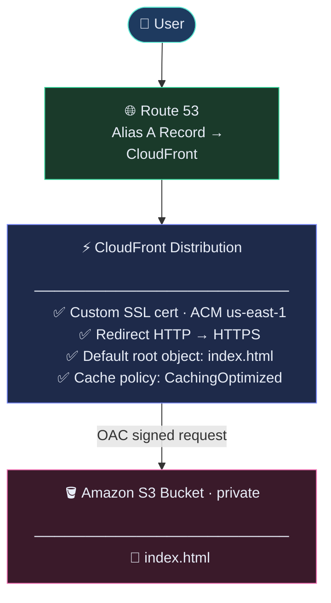

# aws-s3-cloudfront-static-website
Static website hosted on Amazon S3, served globally via Amazon CloudFront with Origin Access Control (OAC), custom apex domain on Route 53, and automated TLS via AWS Certificate Manager (ACM).

# Overview
This project demonstrates how to deliver a static website at the edge using core AWS networking and storage services — with zero servers to manage, automatic HTTPS, and a real custom domain.

Layer | Service | Role 
--- | --- | --- 
Storage | Amazon S3 | Private origin;no public bucket access 
CDN | Amazon CloudFront | Global edge delivery (400+ PoPs) 
Security | OAC + ACM	 | Signed requests to S3; managed TLS cert 
DNS | Amazon Route 53 | Public hosted zone; Alias A record at apex 
Domain | GoDaddy (registrar) | Nameservers delegated to Route 53 

# Architecture

