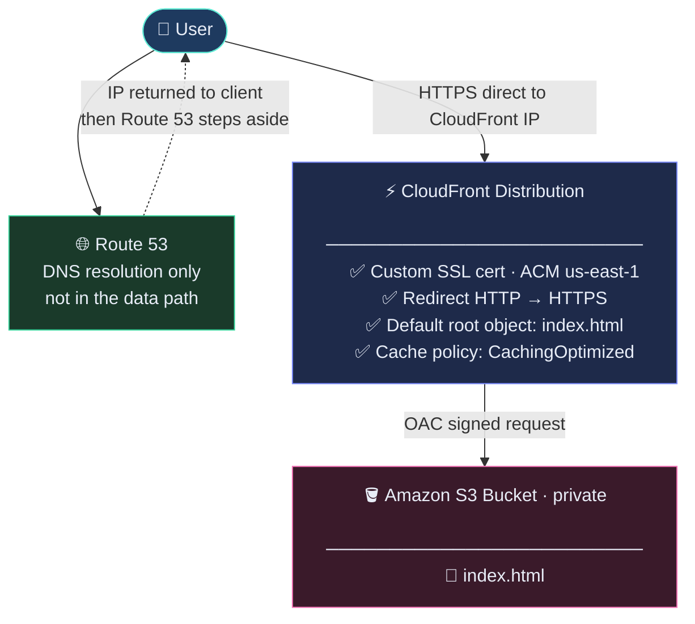

# aws-s3-cloudfront-static-website
Static website hosted on Amazon S3, served globally via Amazon CloudFront with Origin Access Control (OAC), custom apex domain on Route 53, and automated TLS via AWS Certificate Manager (ACM).

**Live demo :** https://leapmotion.ai

## Overview
This project demonstrates how to deliver a static website at the edge using core AWS networking and storage services — with zero servers to manage, automatic HTTPS, and a real custom domain.


Layer | Service | Role 
--- | --- | --- 
Storage | Amazon S3 | Private origin; no public bucket access 
CDN | Amazon CloudFront | Global edge delivery (400+ PoPs) 
Security | OAC + ACM	 | Signed requests to S3; managed TLS cert 
DNS | Amazon Route 53 | Public hosted zone; Alias A record at apex 
Domain | GoDaddy (registrar) | Nameservers delegated to Route 53 


## Architecture



## Prerequisites
- AWS account with console access
- Domain name registered (GoDaddy or any registrar)
- AWS CLI installed and configured (aws configure)

## Step-by-Step Setup
### 1. Delegate DNS to Route 53   
- Route 53 → Hosted zones → Create hosted zone → enter your domain → Public.
- Copy the four NS values from the zone's NS record.
- At your registrar (GoDaddy): Nameservers → Change → I'll use my own → paste all four.
- Verify propagation:
    
``` 
dig NS yourdomain.com +short
    
```


### 2. Create the S3 origin bucket

```
aws s3api create-bucket \
  --bucket your-bucket-name \
  --region ap-southeast-1 \
  --create-bucket-configuration LocationConstraint=ap-southeast-1
```

- Block Public Access: ON (default — keep it)
- Do not enable Static Website Hosting

Upload the site:

```
aws s3 cp site/index.html s3://your-bucket-name/index.html \
  --content-type "text/html"
```

### 3. Request a TLS certificate (ACM)

⚠️ Must be in us-east-1 — CloudFront only reads certs from that region.

- ACM (us-east-1) → Request public certificate.
- Add yourdomain.com and *.yourdomain.com.
- DNS validation → Create records in Route 53 (one click).
- Wait for status Issued (2–15 min).

### 4. Create the CloudFront distribution

Setting | Value  
--- | ---  
Origin domain | S3 bucket REST endpoint  
Origin access | Origin Access Control (OAC) — create new  
Viewer protocol | Redirect HTTP to HTTPS	  
Cache policy | CachingOptimized  
Alternate domain names | yourdomain.com
Custom SSL certificate | Select the ACM cert from step 3  
Security policy | 	TLSv1.2_2021
Default root object | index.html

After creating, copy the OAC bucket policy from the banner and proceed to step 5.

### 5. Attach the bucket policy

Fill in the placeholders in [`policies/bucket-policy.json`](policies/bucket-policy.json). It grants CloudFront s3:GetObject plus s3:ListBucket, so a missing page returns 404 Not Found instead of a misleading 403 Access Denied.

```
aws s3api put-bucket-policy \
  --bucket your-bucket-name \
  --policy file://policies/bucket-policy.json
```

Apply it:

```
aws s3api put-bucket-policy \
  --bucket your-bucket-name \
  --policy file://policies/bucket-policy.json
```

Test before touching DNS:
```
curl -I https://xxxxxxxxxxxxxx.cloudfront.net
# expect: HTTP/2 200
```

### 6. Create the Route 53 alias record

Route 53 → hosted zone → Create record:

Field | Value  
--- | ---  
Record name | (blank — apex)  
Type | A 
Alias | ON	  
Route traffic to | 	Alias to CloudFront distribution  


Repeat with type AAAA for IPv6.

### 7. Verify

```
dig A yourdomain.com +short          # CloudFront IP addresses
curl -I https://yourdomain.com       # HTTP/2 200 + x-cache header
```

### Deploying Updates


```
# Upload changed files
aws s3 sync site/ s3://your-bucket-name/ --delete

# Invalidate the CloudFront cache
aws cloudfront create-invalidation \
  --distribution-id YOUR_DISTRIBUTION_ID \
  --paths "/*"
```

The first 1,000 invalidation paths per month are free.

## Lessons learned

- **Unlisting a domain does not release it.** After unlisting on Afternic, the nameservers still pointed at Afternic, so the "for sale" page kept appearing. The fix was the nameserver change in step 1.
- **Correct nameservers are not enough.** `dig NS` returned the Route 53 servers, but `curl` failed with *Could not resolve host*: the hosted zone had no apex A record. Checking `dig NS` and `dig A` separately showed which layer was missing.
- **Route 53 is not in the data path.** It only answers the DNS lookup; the browser then connects straight to CloudFront's IP addresses.
- **Test the `*.cloudfront.net` URL first.** It separates CloudFront and S3 problems from DNS problems.

## Troubleshooting

Symptom | Likely cause | Fix 
--- | --- | --- 
Still shows registrar parked page | Nameservers not propagated yet | Wait 10–60 min; re-run dig NS 
ACM cert stuck on Pending | Validation CNAME not in Route 53 | Check hosted zone for the _acme-challenge record 
Cert not selectable in CloudFront | Cert not in us-east-1 | Re-request the cert in N. Virginia 
403 AccessDenied XML at root | Bucket policy missing or OAC not attached | Re-apply policy; confirm OAC is set on the origin
403 at / but /index.html loads | Missing default root object | Set index.html in General → Edit 
Old content still showing | CloudFront cache | Run an invalidation for /*
curl: Could not resolve host | No A record in Route 53 | Create the Alias A record (Step 6)
403 on sub-folders like /about | Default root object applies only to / | Fixed in Phase 2 (viewer-request function)


## Cost Estimate

Resource | Cost  
--- | ---  
Route 53 hosted zone | 	$0.50 / month  
ACM public certificate | Free 
CloudFront (free tier) | 1 TB out + 10M requests free / month	  
S3 storage + requests | 	Negligible for a static site

Total for a demo or portfolio site: ~$0.50 / month.

## Cleanup
To avoid ongoing charges when you're done:

```
# 1. Disable and delete the CloudFront distribution (must disable first, wait ~5 min)
# 2. Delete all objects in the bucket
aws s3 rm s3://your-bucket-name --recursive

# 3. Delete the bucket
aws s3api delete-bucket --bucket your-bucket-name

# 4. Delete the ACM certificate (ACM console, us-east-1)
# 5. Delete the Route 53 hosted zone (will stop the $0.50/month charge)
```

## Skills Demonstrated
- Amazon S3 — private origin with least-privilege OAC instead of legacy OAI
- Amazon CloudFront — distribution config, cache policies, alternate domains, HTTPS redirect
- AWS Certificate Manager — DNS-validated public cert in the correct region
- Amazon Route 53 — public hosted zone, Alias records at the apex (no CNAME hack)
- DNS management — nameserver delegation from a third-party registrar
- AWS CLI — bucket creation, policy attachment, sync, cache invalidation
